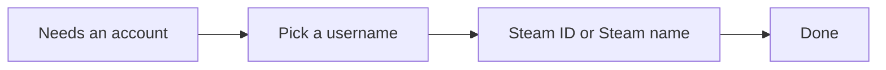
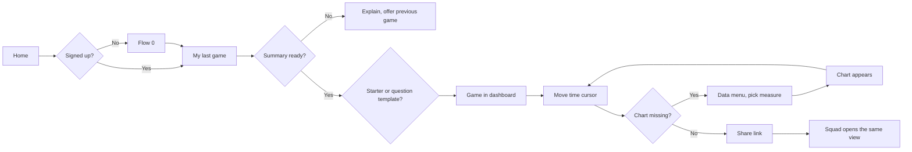
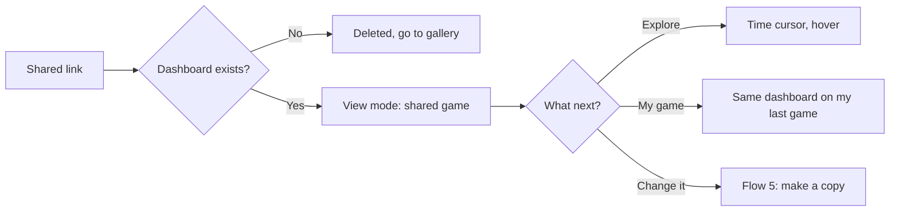
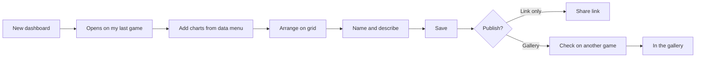
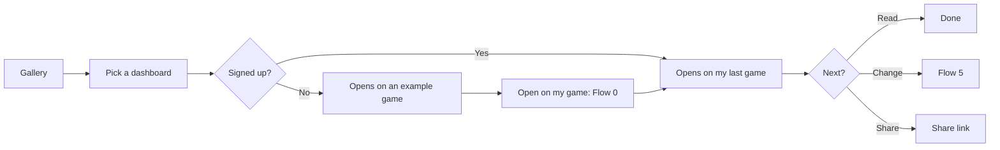
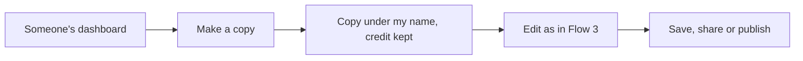
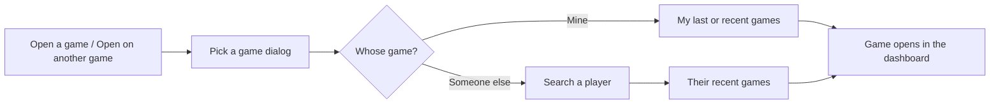

**Step:** [3. Ideate](Step-3-Ideate) · **Status:** `Done` (from assumptions; check against #3 and #4) · **Owner:** iman244 · **Last updated:** 2026-10-23

> **Goal:** Define the steps a user takes to finish key tasks.

## Inputs

Check each input is done and linked before you start.

- [ ] **[#4 Field study observations](04-Field-study-observations)**
  - **Why it's needed:** Flows should follow the real order and shortcuts users take.
  - **How it's used:** Observed task steps inform user flows.
  - **Reference:** [Contextual Inquiry](https://www.nngroup.com/articles/contextual-inquiry/)
  - **This cycle:** Not done yet. The flows use iman244's own account of how the squad reviews games ([#1](01-Stakeholder-interview-notes)). Check them against a real review session.
- [x] **[#9 Personas](09-Personas)**
  - **Why it's needed:** Flows need a user goal to start from and a context to design for.
  - **How it's used:** Flows are designed around persona goals and scenarios.
  - **Reference:** [Personas: Study Guide](https://www.nngroup.com/articles/personas-study-guide/) (NN/g states this)
- [x] **[#11 Customer journey map](11-Customer-journey-map)**
  - **Why it's needed:** Flows are zoomed-in views of steps inside journey stages.
  - **How it's used:** Journey stages are broken into detailed user flows.
  - **Reference:** [User Journeys vs. User Flows](https://www.nngroup.com/articles/user-journeys-vs-user-flows/) (NN/g states this)

## Template

NN/g template: **Partial**

- [Storyboard Template (PDF)](https://media.nngroup.com/media/articles/attachments/Storyboard-Template.pdf)

## Content

> **Reviewed by iman244 on 2026-10-23.** Built from the proto-personas ([#9](09-Personas)), the Squad Reviewer journey ([#11](11-Customer-journey-map)) and the Version 1 ideas in [#20](20-Prioritized-concepts). Idea numbers in brackets, like (#23), refer to [#14](14-Brainstorm-ideas). Choices marked _(Claude's call)_ are open to change.

### Flow 0: Sign up (used inside other flows)

- **Persona:** Any.
- **Entry point:** The first time someone does something that needs an account: opening "my last game", saving, sharing a changed dashboard or publishing.
- **Steps:**
  1. They pick a **username** (any name they like).
  2. They fill in a **Steam ID or Steam name**. This is the AoE4 player whose games "my last game" shows.
  3. Done. The app trusts what they typed and does not check it (iman244, 2026-10-23).
- **Decision points:** None.
- **Success end state:** They have an account, and "my last game" works.
- **Error paths:** The Steam ID or name doesn't match any AoE4 player: "my last game" says so, and they can change the field in their account.
- **Left to the build:** whether there is a password; what happens if a Steam name matches several players.

### Flow 1: Review my last game with the squad

- **Persona:** The Squad Reviewer.
- **Entry point:** The game just ended; they open the app's home page.
- **Steps:**
  1. Home shows **"My last game"** with map, mode, result and each player's civilization (#1). The first time, they sign up (Flow 0).
  2. They open it. The game appears in a **starter dashboard**, "Match overview" (#11), or they pick a **question template** such as "Did trade pay off?" (#18).
  3. They look into a specific question. They move the **time cursor**, and every chart shows the same moment (#21).
  4. They need a chart that isn't there. They open the **data menu** (Economy, Military, Tech and upgrades, Ages and landmarks, Events) (#6), read the one-line explanation (#9), and pick a measure such as "Army DPS" (#14, #15).
  5. The chart **appears at once**: a line over game time for every player, with age-ups marked (#10).
  6. They click **Share** and copy the link, which holds the dashboard and the game (#23). They paste it into the squad's Discord.
- **Decision points:**
  - Starter dashboard or a question template?
  - Is the needed chart already there, or does it need adding?
  - Save the changed dashboard before sharing? Sharing a changed dashboard saves it under their name _(Claude's call)_.
- **Success end state:** The squad is looking at the same game, in the same dashboard, through one link.
- **Error paths:**
  - The game isn't available yet (still in progress, or aoe4world hasn't processed it): say so, offer the previous game, and offer to try again in a minute.
  - The summary can't be loaded (a private match history, or aoe4world refused the request): explain plainly, and offer other games.
  - Someone looks for map control: the data menu says "Map control: not in the data" with a short reason (a minimal form of #37).

### Flow 2: Open a link someone shared

- **Persona:** The Lens Borrower (and the rest of the squad in Flow 1).
- **Entry point:** A link in Discord, Reddit or Twitch.
- **Steps:**
  1. The link opens the dashboard on the shared game, in **view mode**. No account is needed.
  2. They explore: move the time cursor and hover over charts.
  3. Optional: **"Open on my game"** shows the same dashboard on their own last game (Flow 0 runs if needed), or **"Open on another game"** lets them pick any player's game (Flow 6).
  4. Optional: **"Make a copy"** to change it (Flow 5).
- **Decision points:** Just look, use it on my game, or copy it?
- **Success end state:** They see the shared view, or the same dashboard on their own game.
- **Error paths:**
  - The dashboard was deleted: say so, and link to the gallery.
  - They try to edit: the app explains it's someone else's dashboard and offers "Make a copy".
  - The dashboard was built on a 1v1 and their game is a 4v4: charts show every player in the game. A dashboard refers to "the players", never to particular people _(Claude's call, from Grafana's empty data slots in [#7](07-Competitive-analysis))_.

### Flow 3: Build a dashboard and publish it to the gallery

- **Persona:** The Analyst Creator (anyone can do this).
- **Entry point:** "New dashboard" on the home page or in the gallery.
- **Steps:**
  1. A new dashboard opens on **their last game**, so they build with real data (Flow 0 runs if needed).
  2. They add charts from the **data menu**. Each appears straight away (#6, #9, #10, #14, #15).
  3. They arrange charts on a grid: drag to move, drag a corner to resize.
  4. They **name** the dashboard and add a short description, such as the question it answers.
  5. They **save** it. It's saved under their name.
  6. They **publish** it to the gallery (#29). Before publishing, the app shows how it looks on a different game, so they can check that it works on any game _(Claude's call)_.
- **Decision points:** Keep it private (link only) or publish to the gallery?
- **Success end state:** The dashboard is in the gallery under their name, and it opens any game.
- **Error paths:**
  - Saving without a name: suggest a name, such as the question it answers.
  - Publishing an empty dashboard: not allowed; it needs at least one chart.

### Flow 4: Find a dashboard in the gallery and use it on my game

- **Persona:** The Lens Borrower.
- **Entry point:** "Gallery" from the home page.
- **Steps:**
  1. The gallery lists dashboards with Trending, New and Top tabs (#29). Each card shows the name, author, description and a preview picture.
  2. They open one. It opens on **their last game** if they are signed up; otherwise on an example game, with "Open on my game" _(Claude's call)_.
  3. They read it, or share it, or make a copy.
- **Decision points:** Which dashboard? Use it as it is, or copy it?
- **Success end state:** Their own game, seen through someone else's dashboard.
- **Error paths:** The gallery is empty at launch: show the starter dashboards and question templates as the first entries.

### Flow 5: Copy someone's dashboard and change it

- **Persona:** Any; usually a Lens Borrower becoming a builder.
- **Entry point:** "Make a copy" on a dashboard someone else made (#27).
- **Steps:**
  1. The app makes a copy under their name (Flow 0 runs if needed), marked **"Based on [author]'s dashboard"**.
  2. The copy opens in edit mode on the same game.
  3. They change it as in Flow 3 (add, remove, arrange charts), then save, share or publish.
- **Decision points:** Keep it private or publish it?
- **Success end state:** Their own version, with credit to the original author. The original is unchanged.
- **Error paths:** None special. The original can't be changed by anyone but its author.

### Flow 6: Open another player's game

- **Persona:** The Analyst Creator (also anyone curious about a friend's or a pro's game).
- **Entry point:** "Open a game" on Home, "Open on another game" on the dashboard page, or "New dashboard".
- **Steps:**
  1. The **Pick a game** dialog opens, showing my last game and my recent games.
  2. They type a player's name in **Search a player**. Names are suggested as they type (#40).
  3. They pick the player and see that player's recent games (map, mode, result, date).
  4. They pick a game. It opens in the current dashboard, or in the starter dashboard if they came from Home.
- **Decision points:** Which player? Which game?
- **Success end state:** Another player's game, seen through the dashboard they chose.
- **Error paths:**
  - No player matches: say so and keep the search open.
  - The player's match history is private, or a game's summary can't be loaded: say so, and let them pick another game.
- **No account needed** to search and view.

### Screens these flows need (input for [#17 Sitemap](17-Information-architecture-sitemap))

| Screen | Used in flows | What it holds |
|---|---|---|
| **Home** | 1, 3, 4, 6 | My last game, "Open a game", gallery highlights, "New dashboard" |
| **Sign-up dialog** | 0 | Username, Steam ID or Steam name |
| **Dashboard on a game** (view mode) | 1, 2, 4, 6 | Game header, charts, time cursor, Share, Open on my game, Open on another game, Make a copy |
| **Dashboard on a game** (edit mode) | 1, 3, 5 | Same, plus the data menu, adding and arranging charts, name and save |
| **Share dialog** | 1, 2, 3 | Copy link |
| **Publish dialog** | 3, 5 | Description, check on another game, publish |
| **Gallery** | 2, 4 | Tabs, dashboard cards |
| **Pick a game** (dialog) | 2, 4, 6 | My last game, my recent games, **search a player** and their recent games (#40) |
| **My dashboards** | 3, 5 | The dashboards I saved or copied _(Claude's call)_ |

## Feeds into

When this output is done, tell the owners of these outputs.

- **[#17 Information architecture / sitemap](17-Information-architecture-sitemap)**
  - **Why it needs this result:** Without flows, the IA may miss pages users need to finish tasks.
  - **How it's used:** Flows show which content and pages the IA must hold.
- **[#22 Wireframes](22-Wireframes)**
  - **Why it needs this result:** Without flows, wireframes are disconnected screens with no task logic.
  - **How it's used:** Flows define which screens are needed and their order (wireflows).
- **[#25 Usability test tasks](25-Usability-test-tasks)**
  - **Why it needs this result:** Without flows, test tasks may miss critical paths.
  - **How it's used:** Test tasks come from the key flows.

## Definition of done

- [ ] All inputs above are done and linked
- [x] Every section under Content is filled in, with evidence links
- [x] Reviewed by at least one other team member (iman244, 2026-10-23)
- [x] Status set to `Done` here and in the [tracker](Tracker)
- [ ] Owners of the outputs under "Feeds into" are told

## References

- [User Journeys vs. User Flows](https://www.nngroup.com/articles/user-journeys-vs-user-flows/)
