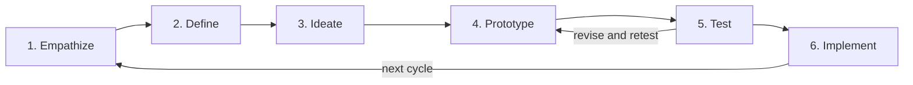

# UX Process Wiki

This wiki is how this project goes from research to a live product. It follows the Nielsen Norman Group (NN/g) design-thinking process: 6 steps and 41 outputs. Each output has its own page with its goal, the inputs it needs and why, an NN/g template, sections to fill in, the outputs it feeds, and a definition of done.

**Interactive graph:** [NN/g Output Flow](https://claude.ai/artifact/MepG6px51nWYgWNmaBLvoL). Click any output to see its inputs, what it feeds, why, templates and references.

## How to use it

1. Use the sidebar to move between steps and outputs.
2. Fill in [Project setup](Project-Setup): product, team, scope.
3. Work step by step. Open a step page, then each output page.
4. Before starting an output, check its **Inputs** list. Every input should be done.
5. Download the NN/g template if there is one, fill in the **Content** sections, and link evidence.
6. Tick the **Definition of done**, update the [Tracker](Tracker), and tell the owners listed under **Feeds into**.
7. When a step is skipped or an output is not needed, mark it `Skipped (reason)` in the tracker. Don't delete the page.

## Process

| Step | Goal | Outputs |
|---|---|---|
| [1. Empathize](Step-1-Empathize) | Learn who the users are, what they need, and the business context. | #1–#7 (7) |
| [2. Define](Step-2-Define) | Turn research into a clear, shared problem definition. | #8–#13 (6) |
| [3. Ideate](Step-3-Ideate) | Generate many solutions, structure content, and choose what to build. | #14–#20 (7) |
| [4. Prototype](Step-4-Prototype) | Make the chosen concepts testable as cheaply as possible. | #21–#24 (4) |
| [5. Test](Step-5-Test) | Find usability problems before building, then fix and retest. | #25–#32 (8) |
| [6. Implement](Step-6-Implement) | Ship, measure against targets, and feed results into the next cycle. | #33–#41 (9) |

## Most important outputs

These feed the most other outputs. If they are weak, everything after them is weak.

- [#9 Personas](09-Personas): feeds 7 outputs
- [#2 Business goals and constraints](02-Business-goals-and-constraints): feeds 6 outputs
- [#4 Field study observations](04-Field-study-observations): feeds 6 outputs
- [#3 User interview recordings and notes](03-User-interview-recordings-and-notes): feeds 5 outputs
- [#6 Analytics and support-ticket review](06-Analytics-and-support-ticket-review): feeds 5 outputs
- [#11 Customer journey map](11-Customer-journey-map): feeds 5 outputs

## Rules

- Every claim links to evidence (a recording, a note, a data source).
- Test with 5 users per round and iterate at least twice.
- Don't release with open severity 3 or 4 issues.
- The benchmark report (#41) starts the next cycle at Step 1.

## Sources

- [NN/g Design Thinking 101](https://www.nngroup.com/articles/design-thinking/)
- [NN/g UX Research Cheat Sheet](https://www.nngroup.com/articles/ux-research-cheat-sheet/)
- [NN/g Free UX Templates](https://www.nngroup.com/articles/free-ux-templates/)
- Links between outputs marked "NN/g states this" are described in the linked NN/g article. The others follow the process logic and link to NN/g's article on that method.
