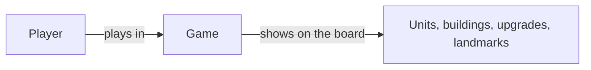
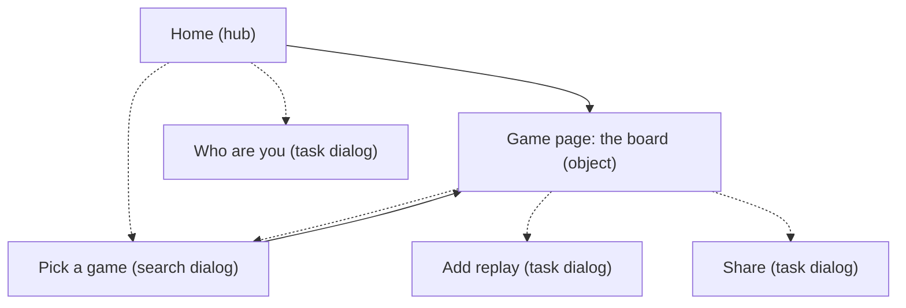

# Sitemap

_Draft, 2026-10-25. Waiting for iman244's review. Built from the [tasks and flows](tasks-and-flows.md)._

## How the pages were found

1. **Tasks** are what people come to do: verbs, such as "look at my last game".
2. **Objects** are the things those tasks are about: nouns, such as a Game or a Player.
3. Every object people open gets an **object page**. Every task that needs its own steps gets a **task page** or a dialog. Finding one object by name is a **search**.
4. The **sitemap** puts those pages in a tree, with Home as the hub that leads to the top tasks.

## Objects

| Object | What it is | What it holds | Where people see it |
|---|---|---|---|
| **Game** | One 1v1 match | Map, date, result, the two players, the aoe4world summary, maybe the replay file | **Game page** (the board) |
| **Player** | An AoE4 player | Name, civilization in each game, recent games | Pick a game (search), the Game page header |
| Civilization, unit, building, upgrade, landmark | The game's own reference data | Cost, build time, icon | As tiles on the board, with details on hover. **No pages of their own**: aoe4world already has them _(Claude's call)_ |



## Page types

| Page type | What it's for | Pages | Tasks it serves |
|---|---|---|---|
| **Hub** | Start here, then go straight to a top task | Home | T1, T6 |
| **Object page** | Everything about one thing | **Game page** (the board) | T1–T5 |
| **Search** | Find one thing by name | Pick a game (dialog): search a player, then their games | T6 |
| **Task dialog** | Do one job, then go back | Add replay, Who are you, Share | T5, T7, T8 |

## Sitemap (tree)

**Pages** (page type in brackets)

```
- Home                                   /                               [Hub]
  - My last game (card)                  → Game page
  - Open a game (button)                 → Pick a game dialog
- Game page (one 1v1 game: the board)    /games/[game]                   [Object]
  - Header: map, result, players and civilizations
  - Timeline: play / pause (Space), speed, drag to a moment
  - Advantage strip: age and relics · upgrades · buildings · units (economy | military)
  - Each player: resources, age, assets
    - Landmarks · Economy · Technologies · Religion · Army · Navy (fold / open)
  - Section bar (right side): jump to a section
  - Share (button) · Open a game (button) · Add the replay (note, when production is missing)
```

**Dialogs (open on top of a page)**

```
- Pick a game      my last game, my recent games,                        [Search]
                   search a player → their recent games
- Add replay       where the file is, drop zone, same-game check (Flow 2) [Task]
- Who are you      Steam ID or Steam name (Flow 4)                       [Task]
- Share            copy link                                             [Task]
```

**The same tree as a picture**



Solid lines are pages; dotted lines open a dialog.

## Labels

| Label | Meaning |
|---|---|
| **Board** | Both players side by side at one moment: buildings, units, upgrades, landmarks |
| **Timeline** | Play, pause and drag through the game |
| **Advantage strip** | The row at the top of the board that shows who's ahead, and by how much |
| **Assets** | What everything a player has is worth now: standing buildings, living units, researched upgrades |
| **Spent** | Everything put into a building so far: assets, lost and queued |
| **Bank** | Resources collected but not spent yet |
| **Replay** | The game's own recording file. It adds production queues. |

## Why it's built this way

- **Only two pages: Home and the Game page.** Every flow ends on the board.
- **The board moves from `/sandbox/[game]` to `/games/[game]`**, so the address names the thing it shows, and a link always opens the same game. _(Claude's call)_
- **Games are 1v1**, because the board compares exactly two players.
- **Dialogs instead of pages** for picking a game, adding the replay and sharing: short steps that shouldn't lose your place on the board.
