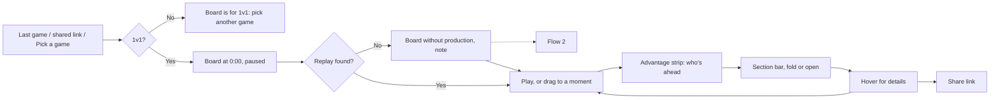
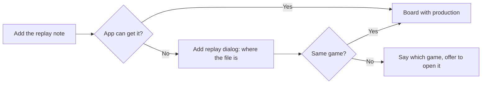
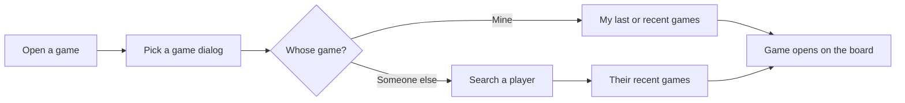

# Tasks and flows

_Draft, 2026-10-25. Waiting for iman244's review._

## Tasks

What people come to the app to do, in their own words. Each task is about one thing in the app (an _object_, see [Sitemap](sitemap.md#objects)) and is done through one of the flows below. **Top tasks are in bold**: Home and the navigation must make these the quickest. _(The list and the top tasks are Claude's call, from the [persona](persona.md), the [journey](journey.md) and what's built.)_

| # | Task | How often | About | Flow | State |
|---|---|---|---|---|---|
| T1 | **Look at the game I just played** | After most games | Game | 1 | To build ("my last game" on Home) |
| T2 | **See what each of us had at one moment**: buildings, units, upgrades, landmarks | Every review | Game | 1 | Built |
| T3 | **Find where I fell behind**: age, upgrades, buildings, units, resources left in the bank | Every review | Game | 1 | Built |
| T4 | Check whether my buildings kept producing or sat idle | Often | Game | 1, 2 | Built (needs the replay) |
| T5 | Show someone the same game: a link to the board | Often | Link | 1 | Built (the page address); a Share button to build |
| T6 | Open any player's 1v1 game: a friend's, a pro's, the opponent's | Weekly | Player, then Game | 3 | To build |
| T7 | Add the replay file so production shows | When the app can't get it | Game | 2 | To build |
| T8 | Tell the app who I am, so it can find my last game | Once | Account | 4 | To build |

## Flow 1: Review a 1v1 game on the board

- **Entry point:** Their last game on Home, a link someone shared, or a game picked in Pick a game (Flow 3).
- **Steps:**
  1. The **board** opens: both players side by side, the time at **0:00**, paused, speed **5×**.
  2. They press **Space** (or Play) to watch the game build up, or drag the **timeline** to a moment they remember, such as a lost fight.
  3. They read the **Advantage strip** at the top: who's ahead in age and relics, upgrades, buildings and units, split into economy and military.
  4. They jump to a section with the **section bar** on the right (Landmarks, Economy, Technologies, Religion, Army, Navy), or fold the sections they don't need. A folded section shows a one-line summary; clicking it opens the section.
  5. They **hover** for details:
     - a building card's bar: what was spent there, against the opponent's same building;
     - the resources: gathered and banked over the game, for both players;
     - the assets number: how it splits into buildings, units and upgrades, and how much sits unspent in the bank.
  6. They find the moment it went wrong, and share the link if they want to talk it over.
- **Decision points:** Watch it play, or jump to a moment? Which section answers their question?
- **Success end state:** They can say what the opponent had that they didn't, and when.
- **Error paths:**
  - **It's a team game:** the board compares two players, so it says the board is for 1v1 games and offers to pick another game _(Claude's call)_.
  - **No replay file:** the board works from the aoe4world summary alone, but production queues don't show. A note says "Add the replay to see production" (Flow 2).

## Flow 2: Add the replay file

- **Entry point:** The "Add the replay" note on the board.
- **Steps:**
  1. The app first tries to get the replay by itself, while the game servers still keep it _(to check: how long replays are kept, and whether aoe4world allows this)_.
  2. If it can't, the **Add replay** dialog shows where the file is on their PC, in the game's `playback` folder under `Documents\My Games\Age of Empires IV` _(to check)_.
  3. They drop the file in. The app checks it's the same game by matching the players.
  4. The board reloads with production queues on the building icons.
- **Decision points:** Find the file now, or carry on without production?
- **Success end state:** Production queues show on the board.
- **Error paths:**
  - The file is from another game: say which game it is, and offer to open that one instead.
  - The file can't be read (for example, after a game update): say so plainly; the board stays as it was.
- **Left to the build:** whether an added replay is kept, so the next person opening the same game gets production too.

## Flow 3: Open a game

- **Entry point:** "Open a game" on Home or on the board.
- **Steps:**
  1. The **Pick a game** dialog opens, showing their last game and recent games (if the app knows who they are, Flow 4).
  2. They type a player's name in **Search a player**. Names are suggested as they type.
  3. They pick the player and see that player's recent games (map, result, date).
  4. They pick a 1v1 game. It opens on the board. Team games are shown but can't be opened _(Claude's call)_.
- **Success end state:** The game they wanted, on the board.
- **Error paths:**
  - No player matches: say so and keep the search open.
  - A game's summary can't be loaded: say so, and let them pick another game.
- **No account needed** to search and view.

## Flow 4: Tell the app who I am

- **Entry point:** "My last game" on Home, the first time.
- **Steps:**
  1. They type their **Steam ID or Steam name**, or their aoe4world player name _(Claude's call)_.
  2. Done. Home now shows their last game.
- **Error paths:** No AoE4 player matches: say so, and let them try again.
- **Left to the build:** whether this is a real account or just remembered in the browser.

## Screens these flows need (input for the [sitemap](sitemap.md))

| Screen | Used in flows | What it holds |
|---|---|---|
| **Home** | 1, 3, 4 | My last game, "Open a game" |
| **Game page** (the board) | 1, 2 | Advantage strip, both players' landmarks, economy, technologies, religion, army and navy at one moment, timeline, section bar, Share |
| **Pick a game** (dialog) | 3 | My last game, my recent games, search a player and their recent games |
| **Add replay** (dialog) | 2 | Where the file is, a drop zone, the same-game check |
| **Who are you** (dialog) | 4 | Steam ID or name |
| **Share** (dialog) | 1 | Copy link |
